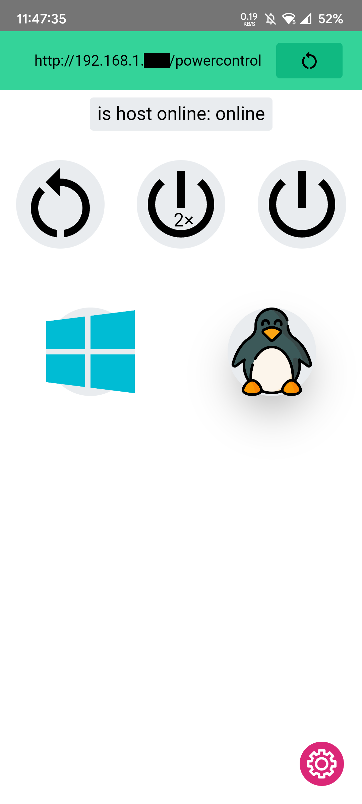
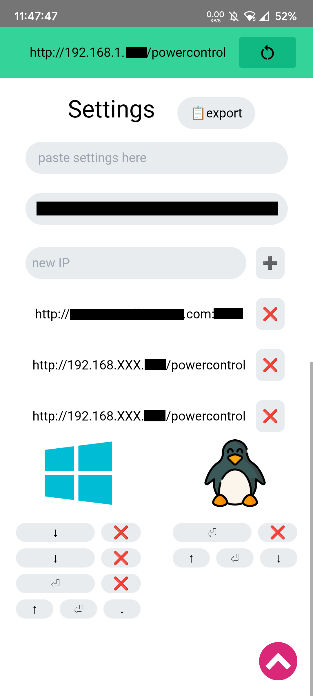
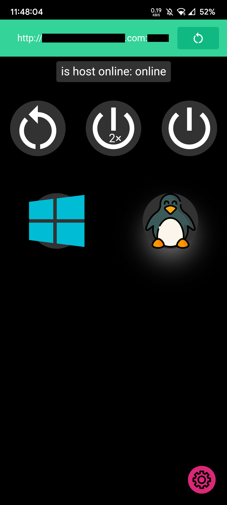
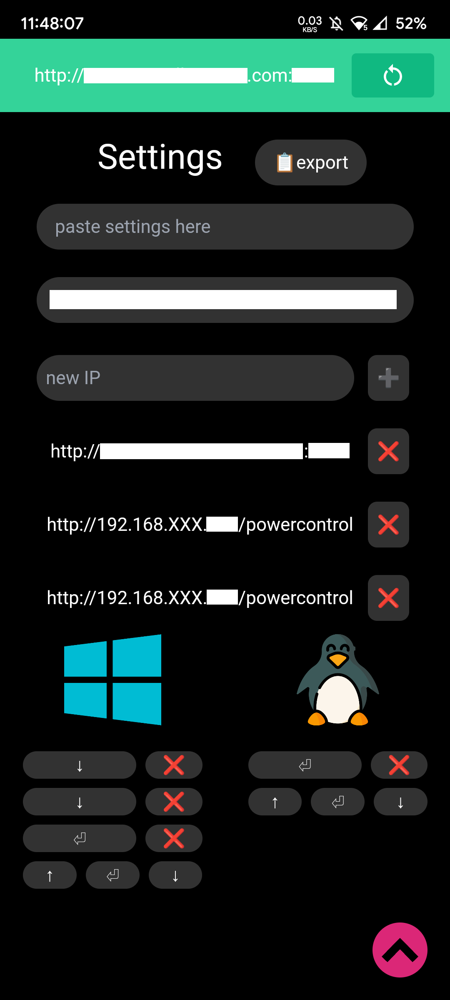
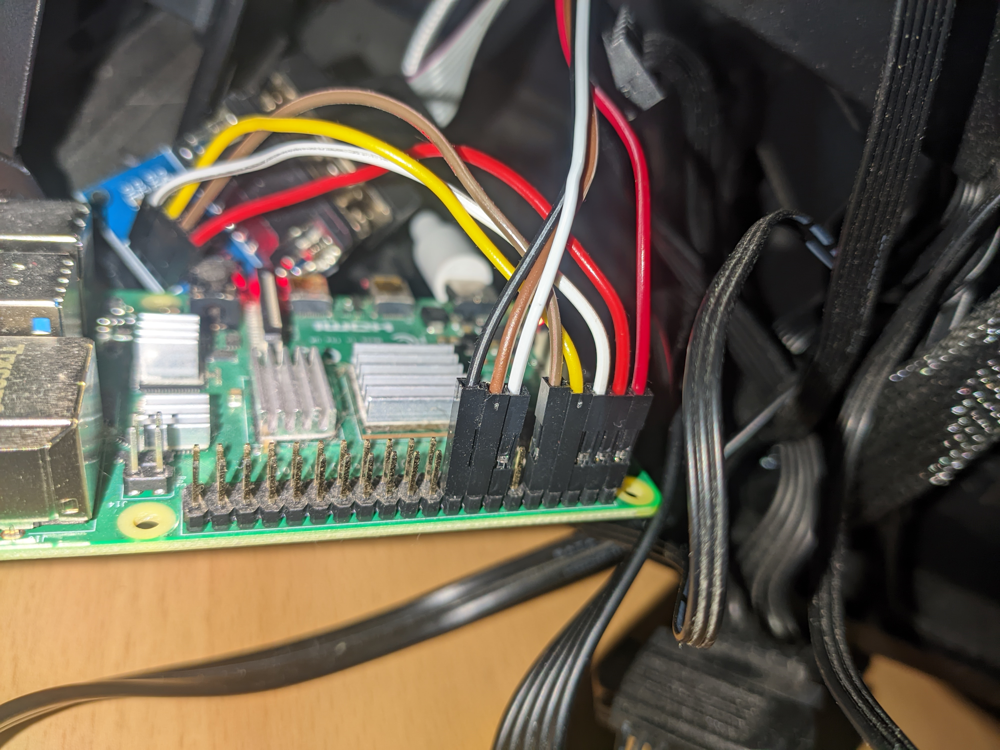
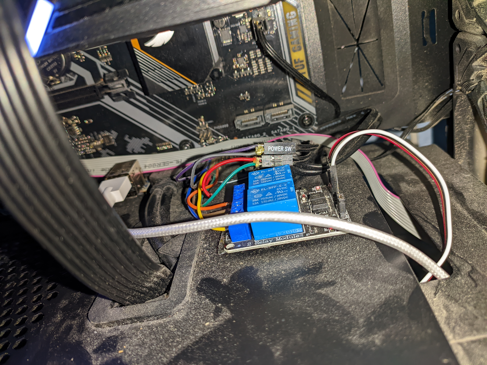

# powercontrol

PC power/reset controller built around a Raspberry Pi, a relay board, and a Vue/Capacitor client.

It can also send serial key presses to the motherboard so the app can select the next GRUB entry before boot.

## Quick start

1. Copy `server/config.example.json` to `server/config.json`.
2. Adjust the GPIO pins, `host_ip`, and `token`.
3. Start the server with `cd server && npm install && npm run dev`.
4. Start the client with `cd client && npm install && npm run dev`.

## Android build

```bash
cd client
npm run android
```

## Pictures

<p float="left">
  
  
  
  
</p>
<p float="left">
  
  
</p>
